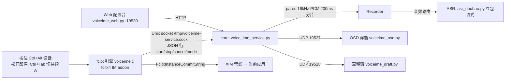

# voice-ime 语音输入法：构建安装与排障经验

> **项目一句话**：ZTE 内网语音输入法——fcitx4 引擎 + 豆包流式 ASR + 可选 LLM 润色 + 4 个 systemd 用户服务。按住 Ctrl+Alt 说话、松开即停上屏（对讲机式），不碰剪贴板。
> **本次经验核心**：三个并发/状态类疑难 bug（修饰键状态泄漏、锁内网络握手死锁、stop 与 on_final 竞态双提交）各有典型教训；安装部署流程已沉淀为可复现步骤（见下）。
> 代码仓库：`~/software/voice-ime`（git，远端 GitHub lzyyzznl/voice-ime）。

## 一、架构



| 服务 | 实现 | 说明 |
|---|---|---|
| voiceime-core | voice_ime_service.py | Unix socket + UDP；录音/ASR/润色/上屏（Python 3.11） |
| voiceime-osd | voiceime_osd.py | UDP 19527 声波浮窗（python3.6 GTK） |
| voiceime-draft | voiceime_draft.py | UDP 19528 草稿窗：暂存+LLM 优化按钮（python3.6 GTK） |
| voiceime-web | voiceime_web.py | HTTP 19530 配置台（多模型/参数/日志） |

## 二、安装部署（可复现）

生产目录：`~/software/voice-ime`（原 `~/下载/voice-ime` 已整体 mv 迁移，git 保留）。

### 1. 依赖

- fcitx4 头文件/库：`/usr/include/fcitx*`、`libfcitx-core`、glib-2.0
- Python 3.11 + websockets（core/web 用 `~/.local/bin/python3`）
- 系统 python3.6（osd/draft 用 `/usr/bin/python3.6`，无 f-string）
- 录音源：`parec`；`pactl list sources short` 查源名，RDP 环境为 `xrdp-source` → config `audio_device`

### 2. 引擎编译安装

```bash
cd ~/software/voice-ime/fcitx-engine
make
sudo -n make install          # 装 /usr/lib64/fcitx/fcitx-voiceime.so + addon conf
# 改引擎 C 后必须重启 fcitx（.so 只在启动时加载）：
pkill fcitx; sleep 2
export DISPLAY=:0 DBUS_SESSION_BUS_ADDRESS="unix:path=/run/user/1000/bus"
setsid fcitx -d
```

### 3. systemd 用户服务

4 个单元在 `~/.config/systemd/user/`，WorkingDirectory 指向生产目录。安装/管理：

```bash
./install.sh                 # 依赖→引擎→图标→systemd 单元→启动
./service.sh restart|status  # systemctl 封装
systemctl --user restart voiceime-core    # 改 config/Python 后重启
```

> [!warning] core 卡死时优雅停止会超时
> 若 core 的 client_loop 卡在锁上（旧 bug），`systemctl restart` 会挂住（SIGTERM handler 里 cancel_session 等同一把锁）。用强制方式：
> `systemctl --user kill -s KILL voiceime-core; systemctl --user reset-failed voiceime-core; systemctl --user start voiceime-core`

### 4. 配置

- `config.json` 含真实密钥，gitignore 不入库；`config.example.json` 入库
- 关键项：`asr_backend=doubao`、`doubao.api_key`、`hold_ms=300`、`llm.models[]+active`、`llm.auto_polish`
- 用户手动改 config 必须尊重；改前先读最新

### 5. 验证（check_env.sh 26 项）

```bash
./check_env.sh                          # 退出码 = 缺失项数
systemctl --user is-active voiceime-core voiceime-draft voiceime-osd voiceime-web  # 全 active
ss -x | grep voiceime                   # 引擎↔core 1 条 ESTAB
fcitx-remote -s voiceime && fcitx-remote # 切语音输入法，返回 2
curl -s http://127.0.0.1:19530/api/state
```

日志：`~/software/voice-ime/logs/voiceime-{engine,service,osd,draft}.log`

## 三、键位设计（现状）

| 按键 | 作用 |
|---|---|
| Ctrl+Alt 按住 | 开始录音（≥0.3s 防误触） |
| 松开 Ctrl/Alt | B 对讲机（默认）：停止并上屏 |
| Ctrl+Tab | 切 A 持续 / B 对讲机（默认 B） |
| Escape | A 持续模式停止提交；草稿窗关窗退草稿 |
| 单独按 Ctrl | A 录音中切草稿 |
| Ctrl+Alt+Shift 三键 | B 空闲切草稿（tri_pressed 防误启录音） |

约束：Shift 单按被 fcitx 绑定切输入法，不能用作切换；Shift 也因此在 voiceime 中只承担三键组合。

## 四、排障经验教训（重点）

### 1. 引擎无法呼出录音：自维护修饰键状态泄漏

- **现象**：切到语音输入法后 Ctrl+Alt 无反应，重启 fcitx 暂时恢复，随后复发。
- **排查**：引擎日志所有按键事件 `shift=1`，而 XQueryKeymap 显示物理 Shift 未按下 → 引擎自维护的 `im->shift_down` 卡在 true。触发录音要求 `!shift_down`（区分三键），条件永不满足。
- **根因**：XIM 按键事件可能丢失释放（尤其 Shift 被 fcitx 用作切输入法，切走/切回时按下松开不配对），引擎自累计标志不可靠。
- **修复**：改用 fcitx 权威传入的 `state`（源自 X server 物理键盘状态）在每次 DoInput/DoReleaseInput 校准：`ctrl_down = state & FcitxKeyState_Ctrl || is_ctrl(sym)`，余类推。
- **教训**：修饰键状态判断永远用事件携带的权威 mods，不要自己累计 true/false——事件会丢，物理状态不会。自维护状态机必须考虑"漏了释放事件"的兜底。

### 2. core 控制通道整体冻结：锁内做网络握手

- **现象**：几次对讲机操作后 core 日志停更（最后一条 stop），后续 mode/草稿/激活命令全部无响应，连接仍 ESTAB、新连接正常响应。
- **根因**：`start_session` 的 `with session.lock:` 从开头贯穿 `_make_asr()`（豆包网络握手，数百 ms~数秒）直到函数尾。stop 分支（client_loop 内）也要取同一把锁置 `cancel_pending` → client_loop 同步阻塞在握手上，后续命令全部堆在内核缓冲无人读。慢/挂起的 doubao 连接 = 控制通道永久冻结。
- **修复**：握手移出锁。锁内只做毫秒级状态重置；`_make_asr()` 锁外跑；回来后重新加锁做取消检查（cancel_pending 早松手自停）+ 挂接 asr + 装配录音流 + 发 started（毫秒级，仍须在锁内防 stop 空窗竞态）。
- **教训**：**绝不持锁做网络/阻塞 IO**。锁内工作保持毫秒级；把"慢操作"与"需要原子性的状态切换"拆开，用标志位（cancel_pending）跨锁通信。单线程事件循环（client_loop）里任何同步阻塞都是全局灾难。

### 3. 一句话重复输出 n 次：stop 与 on_final 竞态双提交

- **现象**：对讲机说一句话立即松手时，输入框概率性出现同一句 2 次。core 日志只有 1 条识别结果、引擎日志同一毫秒收到 2 条相同 commit 消息。按住不动不触发。
- **根因**：`stop_session` 在调用阻塞的 `asr.stop()`（数百 ms）**之前**读取 `committed=0`；阻塞期间 ASR 收尾线程 `on_final` 处理同一句 final（`committed→1` + 走润色队列上屏第 1 次）；`asr.stop()` 返回后 stop 按**旧值** `finals[0:]` 切片认为未提交 → 再次入队上屏第 2 次。
- **修复**（三处协同）：
  1. stop 开始即置 `session.stopping=True`，`on_final` 见标志跳过即时提交，交给 stop 统一收尾（堵双入口）；
  2. `committed` 改在 `asr.stop()` 返回后重读——其语义保证返回时 recv 线程已同步处理完所有 finals（`_handle`→on_final 在 `_completed.set()` 之前同步执行），切片必为空；
  3. `start_session` 每轮重置 `committed=0`（原只在 Session 创建/60s 续录时重置，连录多轮会跨轮错位切片）。`switch_session`（60s 续录）同款竞态一并修。
- **教训**：**计数器在"会阻塞的同步点"前后读取，必须理解阻塞期间的并发副作用**。读值时机与更新者不在同一临界区 = 竞态。跨线程协调要么原子、要么"让位于唯一收尾者"（stopping 门）。另：这类概率性 bug 一定要拿到用户的稳定复现条件（"一句话即松手"vs"按住不动"）才能定位。

### 4. 概率性繁体字：fcitx chttrans 简繁转换

- **现象**：上屏内容有概率变繁体，时繁时不繁。core 日志确认 ASR/润色输出全是简体。
- **根因**：fcitx 的简繁转换插件 chttrans 对 voiceime 启用了（`~/.config/fcitx/conf/fcitx-chttrans.config` 里 `EnabledForIM=voiceime:true`）。它在提交到应用时按应用语言偏好转换——未声明简体的应用被转繁，声明了的则不转 → 表现为概率性。
- **修复**：改为 `EnabledForIM=voiceime:false`，重启 fcitx。
- **教训**：上屏文本被"中间层"二次改写时，先确认输出链路上每个环节（ASR→润色→fcitx 插件→应用）。core 日志证明源头是简体，就查 fcitx 侧，别去调 ASR/提示词。

### 5. 对讲机早松手（<握手期）：cancel_pending 自停

- **现象**：按住刚过 hold_ms 就松开，stop 到达时 ASR 还没建好。
- **机制**：handle 的 stop 先置 `session.cancel_pending=True`；start_session 完成握手加锁后检查该标志 → 关闭刚建的 ASR、回 `done ok:false`、不残留录音。日志特征：`握手期收到 stop（松开过早），放弃本次录音`。
- **教训**：异步握手与用户取消之间的竞态，用"取消标记 + 完成后自检"而不是试图取消进行中的握手。

## 五、测试方法论教训

- **XTest 注入按键**验证 fcitx 引擎（无 xdotool 时用 python ctypes + libXtst）。**必须**给 ctypes 设置 `restype/argtypes`（尤其 `XOpenDisplay` 返回指针），否则 64 位指针截断段错误（code 139）。
- **按键能否到达引擎依赖 XIM grab**：XTest 注入到非 XIM 客户端窗口时 fcitx 不转发 → 注入前先 `fcitx-remote -s voiceime` + 确认焦点在真实输入框（xterm/Obsidian）；裸 XTest 到 root 无效。实测时**不要向用户真实笔记窗口注入 Ctrl+Alt**（会真录音提交），改请用户手按 + 读引擎日志。
- 引擎状态验证看日志（`DoInput sym=... ctrl/alt/shift/recording` 每键一行），比看 UI 可靠。
- python3.6（GTK 窗口）与 3.11（core）双栈：draft/osd 代码不能有 f-string。

## 六、git 提交脉络（本次会话）

- `5b20c5c` 多模型配置；`43325b6` 体验优化（润色反馈/连接池/VAD）；`170b28e` 提示词重构；`8a86923` 目录迁移+文档
- `9773430` 对讲机 B 默认 + Ctrl+Tab 切 A/B + 三键/单 Ctrl 草稿 + 草稿窗五增强 + core 握手锁拆锁
- `1831359` 引擎修饰键 state 校准（修无法呼出）
- `daff21c` core 竞态修复（on_final/stop 双提交 + committed 跨轮重置）

## 参考

- 项目 `README.md`（架构/键位/配置）、`INSTALL.md`（安装/使用表/故障表）、`check_env.sh`
- 键位约束来源：Shift 被 fcitx 占用、Ctrl+Alt 双键为触发核心
