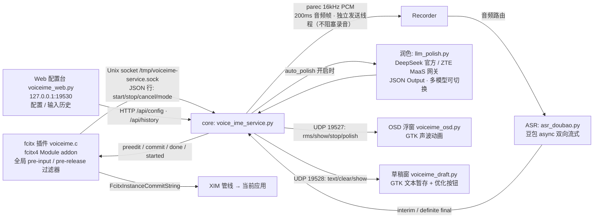

# voice-ime — ZTE 内网语音输入法（fcitx 引擎版）

> **安装与使用：见 [INSTALL.md](INSTALL.md)**（面向 AI 代理的分步指南）

在 ZTE 内网环境下，用**豆包流式语音识别（ASR）**把说话内容直接输入到当前应用，**可选 LLM 自动润色**后再上屏。
**默认对讲机模式：按住 Ctrl+Alt 说话，松开即停并上屏**——不碰剪贴板，一句话说完松手即可。

> 快捷键可改：**按住说话** 与 **按住持续对话** 两组组合在配置台「快捷键」卡片里设置（`ptt_keys` / `hold_keys`）。
> 不抢应用快捷键：按住 Ctrl+Alt 时若又按下别的键（iCenter 的 Ctrl+Alt+Z、终端 Ctrl+Alt+T 等），引擎会放弃本次录音，把它留给应用。

它是 fcitx 4 的 **Module addon**（注册全局按键过滤器），**不占输入法位**：拼音输入法（搜狗）可常驻激活，打字和说话随时切换、不用切输入法。

## 架构



**四个 systemd 用户服务**（`~/.config/systemd/user/`，均 Restart=always）：

| 单元 | 文件 | 端口/通道 | 说明 |
|---|---|---|---|
| `voiceime-core` | `voice_ime_service.py` | Unix socket + UDP 19527/19528 + UDP 19529(草稿控制) | 主服务：录音/ASR/润色/上屏 |
| `voiceime-osd` | `voiceime_osd.py` | UDP 19527 | 录音指示浮窗（声波动画，随润色状态变色） |
| `voiceime-draft` | `voiceime_draft.py` | UDP 19528 | 草稿窗口（暂存 + 一键 LLM 优化） |
| `voiceime-web` | `voiceime_web.py` | HTTP 127.0.0.1:19530 | Web 配置台（改配置/多模型/输入历史/日志/重启） |

## 目录结构

```
voice-ime/
├── fcitx-engine/            # fcitx 插件（C，fcitx4 Module addon）
│   ├── voiceime.c           # 插件主体：全局按键过滤器，Ctrl+Alt 对讲机、Ctrl+Alt+Tab 切模式、commit/preedit
│   ├── fcitx-voiceime.conf  # addon 配置
│   └── Makefile             # make && sudo make install
├── icons/                   # 图标（gen_icons.py + SVG）
├── voice_ime_service.py     # core：Unix socket 服务、录音、ASR 调度、润色队列
├── asr_doubao.py            # 豆包流式 ASR 客户端（bigmodel_async 逐句定稿）
├── llm_polish.py            # LLM 润色共享模块（core 自动润色 + 草稿窗优化）
├── voiceime_osd.py          # 录音浮窗（GTK3，系统 python3.6）
├── voiceime_draft.py        # 草稿窗（GTK3，python3.6）
├── voiceime_web.py          # Web 配置台（HTTP 19530）
├── service.sh               # systemd 快捷管理（start/stop/restart/status）
├── check_env.sh             # 环境检测（退出码 = 缺失项数）
├── install.sh               # 一键安装（依赖→引擎→图标→systemd 单元→启动）
├── config.example.json      # 配置模板（凭证占位，不入库）
├── config.json              # 真实配置（含密钥，不入库，gitignore）
├── eval_set.json            # 润色提示词评估集
├── eval_optimizer.py        # 跑评估集算 PASS 率，对比提示词改动效果
└── logs/                    # 运行时日志（voiceime-*.log）
```

## 使用

对讲机（默认，B）：按住 Ctrl+Alt 说话，**松开即停**并上屏。一句话说完松手即可。
持续（A）：按 **Ctrl+Alt+Tab** 切过去，按住 ≥0.3s 触发录音后**可松手继续说**，说完按 **Escape** 停止提交。

| 按键 | 作用 |
|---|---|
| **Ctrl+Alt 按住** | 开始录音（≥0.3s 防误触，提示音 + 声波浮窗） |
| **松开 Ctrl/Alt** | B 对讲机：停止并上屏 |
| **Ctrl+Alt+Tab** | 切换 A 持续 / B 对讲机模式（默认 B） |
| **Escape** | A 持续模式：停止提交 |
| **单独按 Ctrl** | A 持续录音中：切草稿窗（再按切回） |
| **Ctrl+Alt+Shift 三键** | B 对讲机空闲时：切草稿窗 |

> **快捷键可自定义**：`ptt_keys`（按住说话）与 `hold_keys`（按住持续对话）默认 `ctrl+alt` / `ctrl+alt+space`，在配置台「快捷键」卡片改，保存并重启后生效。下表其余按键（Tab 切模式、Esc、Ctrl/Shift 草稿入口）固定。

1. 保持拼音输入法（搜狗）激活即可；`fcitx-remote` 返回 `2` 表示 fcitx 已激活（否则按 Ctrl+Space 激活）
2. 聚焦目标输入框
3. **对讲机 B**：按住 Ctrl+Alt 说话，松开即停上屏；或 **Ctrl+Alt+Tab** 切到持续 A 按住说话、松手继续录、Escape 停
4. 停顿处句子自动上屏（VAD 500ms 定稿）
5. `auto_polish: true`（Web 配置台开关）时每句先经 LLM 润色再上屏

**自动润色行为**（`llm.auto_polish`）：
- 每句定稿 → 候选栏先显示原句（等待期不空白）→ LLM 润色 → 润色结果上屏
- 浮窗声波随状态变色：**亮黄**=润色中，**红**=润色失败（已回落原文，1.5s 自动恢复）
- 上下文 = 最近 3 个语义句（仅原文，供模型理解语境，禁止串句输出）
- 积压降级：前一句未润色完时新句直接原文上屏（保顺序，延迟有上界）
- 失败/超时（8s）自动回落原文，不丢字

**草稿模式**：录音中单独按一下 Ctrl（A 持续）或空闲时按 Ctrl+Alt+Shift 三键（B 对讲机）→ 弹出草稿窗，后续内容进草稿不上屏；Esc 关窗退出。草稿窗支持：
- 自动带入最近已上屏的历史句（最多 3 句），方便连录后统一整理
- **增量追加**：识别流只往文末加字，**你正在编辑的光标/手动修改不被识别流打断**（光标不飘）
- 底部按钮：**【复制全部】**一键复制原文、【优化】LLM 润色（成功**不自动关窗、不自动复制**，可手改后再复制）、【复制优化结果】复制润色结果
- **Esc** 关窗并退出草稿模式

**Web 配置台**：浏览器开 `http://127.0.0.1:19530`。
- **配置** tab：改 ASR/润色参数、管理多个 LLM 模型（下拉切换、增删、持久化保存）、看实时日志、一键重启。
- **输入历史** tab：每句上屏即记录（`logs/voiceime-history.jsonl`），表格同时展示**识别原文**与**润色后上屏文本**、润色耗时/失败状态；搜索框对两者做模糊匹配（空格分词，全部命中，命中片段高亮），可切换 50/100/300 条与自动刷新。

## 配置（config.json）

| 键 | 说明 |
|---|---|
| `doubao.api_key` | 豆包火山引擎 API Key |
| `doubao.resource_id` | 固定 `volc.seedasr.sauc.duration`（2.0 时长版：按音频时长扣额度、不占并发名额），一般不用改 |
| `doubao.request.end_window_size` | **停顿判停 ms**：句末静音这么久即定稿上屏。调小响应快但易碎句，调大更完整但上屏更迟；推荐 500–800，默认 800 |
| `doubao.request.force_to_speech_time` | **起音保护 ms**：开口后这段时间内不判停，防开头换气被误切成两句；推荐 1000 |
| `doubao.request.accelerate_score` | **加速率 0–10**：仅配合 `enable_accelerate_text`（首字加速）生效，越大首字越快、精度可能略降；推荐 1–2，默认 0 |
| `sample_rate` / `chunk_ms` | 16000 / 200ms 音频分片 |
| `audio_device` | PulseAudio 源名（RDP 环境 `xrdp-source`） |
| `silence_timeout_sec` / `silence_after_input_sec` | 静音自动停止：从未识别 15s / 识别后 30s |
| `silence_rms_threshold` | 静音 RMS 阈值（底噪高调大） |
| `osd.*` | 浮窗宽高/垂直位置 |
| `focus_lost_stop` | 失焦自动停录释放麦克风 |
| `hold_ms` | 长按阈值 ms（300） |
| `ptt_keys` | **按住说话**（对讲机）快捷键，默认 `ctrl+alt`；写法见下 |
| `hold_keys` | **按住持续对话**快捷键，默认 `ctrl+alt+space`；触发后可松手继续说，Esc 停止 |
| `llm.active` | 当前生效模型 id（对应 models[].id） |
| `llm.models[]` | 多模型列表：`{id, name, endpoint, api_key, model, system_prompt}`，配置台可视化管理 |
| `llm.auto_polish` | 每句上屏前 LLM 润色开关 |
| `llm.models[].system_prompt` | 润色提示词：明示「上文/待润色」边界 + 分条规则（详见 example） |

**快捷键写法**：修饰键 `ctrl` / `alt` / `shift` 用 `+` 连接，末尾可加**一个**普通键（`space`、`tab`、`esc`、单个字母数字或 `` ` ``）。例：`ctrl+alt`、`ctrl+shift`、`alt+space`、`ctrl+alt+d`。两个组合不能相同；`hold_keys` 可以以 `ptt_keys` 开头（按下末尾那个键即从对讲机升级为持续模式）。配置台「快捷键」卡片可直接改，保存并重启生效；改后重启 fcitx 才会重新下发到引擎。

**api_key 三种写法**：`sk-` 开头真实密钥 / UUID（内网网关）/ 恰好等于已设环境变量名（从环境读）。

## 构建与安装（详见 INSTALL.md）

```bash
cd ~/workspace/voice-ime
./install.sh                 # 依赖→引擎→图标→systemd 单元→启动→验证
```

## 服务运维（systemd 用户服务）

```bash
systemctl --user status voiceime-core      # 主服务状态
systemctl --user restart voiceime-core     # 改 config.json 后重启生效
journalctl --user -u voiceime-core -f      # 跟随日志
./service.sh restart                       # 等价快捷方式（全部 4 服务）
```

改 `config.json` 后 `restart voiceime-core` 即生效（LLM 段每次调用现读，改模型可即时生效，无需重启）。

## 调试

```bash
cd ~/workspace/voice-ime
tail -f logs/voiceime-engine.log    # 引擎：按键、preedit/commit
tail -f logs/voiceime-service.log   # core：命令/录音/识别/润色耗时
tail -f logs/voiceime-osd.log       # 浮窗
ss -x | grep voiceime               # 引擎↔core 连接（1 条 ESTAB）
fcitx-remote                        # 输入法状态（2=激活；语音需要激活态）
```

## 润色模型接入（多模型）

`config.json` 的 `llm` 段支持任意多个 OpenAI 兼容 chat/completions 端点：

```json
"llm": {
  "auto_polish": true,
  "active": "zte",
  "models": [
    {"id": "zte", "name": "ZTE MaaS 网关",
     "endpoint": "https://maas-apigateway.dt.zte.com.cn/model/.../v1/chat/completions",
     "api_key": "<UUID>", "model": "deepseek-v4-flash", "system_prompt": "..."},
    {"id": "deepseek", "name": "DeepSeek 官方",
     "endpoint": "https://api.deepseek.com/v1/chat/completions",
     "api_key": "<sk-...>", "model": "deepseek-v4-flash", "system_prompt": "..."}
  ]
}
```

切换 `llm.active`（配置台下拉或手改）即换模型，**连接按模型复用**（TLS 握手只一次）。
