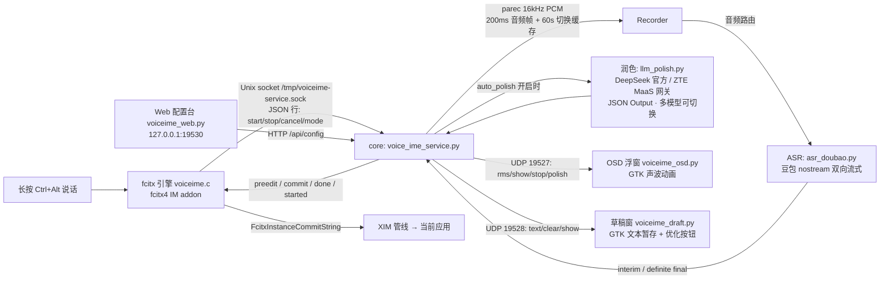

# voice-ime — ZTE 内网语音输入法（fcitx 引擎版）

> **安装与使用：见 [INSTALL.md](INSTALL.md)**（面向 AI 代理的分步指南）

在 ZTE 内网环境下，用**豆包流式语音识别（ASR）**把说话内容直接输入到当前应用，**可选 LLM 自动润色**后再上屏。
**长按 Ctrl+Alt ≥0.3s** 开始录音（可松手），**按 Escape** 停止提交——全程不碰剪贴板。

## 架构



**四个 systemd 用户服务**（`~/.config/systemd/user/`，均 Restart=always）：

| 单元 | 文件 | 端口/通道 | 说明 |
|---|---|---|---|
| `voiceime-core` | `voice_ime_service.py` | Unix socket + UDP 19527/19528 + UDP 19529(草稿控制) | 主服务：录音/ASR/润色/上屏 |
| `voiceime-osd` | `voiceime_osd.py` | UDP 19527 | 录音指示浮窗（声波动画，随润色状态变色） |
| `voiceime-draft` | `voiceime_draft.py` | UDP 19528 | 草稿窗口（暂存 + 一键 LLM 优化） |
| `voiceime-web` | `voiceime_web.py` | HTTP 127.0.0.1:19530 | Web 配置台（改配置/多模型/日志/重启） |

## 目录结构

```
voice-ime/
├── fcitx-engine/            # fcitx 引擎（C 插件，fcitx4）
│   ├── voiceime.c           # 引擎主体：拦截 Ctrl+Alt、commit/preedit
│   ├── fcitx-voiceime.conf  # addon 配置
│   └── Makefile             # make && sudo make install
├── icons/                   # 图标（gen_icons.py + SVG）
├── voice_ime_service.py     # core：Unix socket 服务、录音、ASR 调度、润色队列
├── asr_doubao.py            # 豆包流式 ASR 客户端（nostream 定稿）
├── asr_client.py            # iCenter ASR 客户端（旧后端，保留兼容）
├── llm_polish.py            # LLM 润色共享模块（core 自动润色 + 草稿窗优化）
├── voiceime_osd.py          # 录音浮窗（GTK3，系统 python3.6）
├── voiceime_draft.py        # 草稿窗（GTK3，python3.6）
├── voiceime_web.py          # Web 配置台（HTTP 19530）
├── service.sh               # systemd 快捷管理（start/stop/restart/status）
├── check_env.sh             # 环境检测（退出码 = 缺失项数）
├── install.sh               # 一键安装（依赖→引擎→图标→systemd 单元→启动）
├── config.example.json      # 配置模板（凭证占位，不入库）
├── config.json              # 真实配置（含密钥，不入库，gitignore）
└── logs/                    # 运行时日志（voiceime-*.log）
```

## 使用

1. 输入法切换到「语音输入」
2. 聚焦目标输入框
3. **按住 Ctrl+Alt ≥0.3s** 开始录音（提示音 + 声波浮窗；可松手）
4. 停顿处句子自动上屏（VAD 500ms 定稿）；**按 Escape** 停止提交
5. `auto_polish: true`（Web 配置台开关）时每句先经 LLM 润色再上屏

**自动润色行为**（`llm.auto_polish`）：
- 每句定稿 → 候选栏先显示原句（等待期不空白）→ LLM 润色 → 润色结果上屏
- 浮窗声波随状态变色：**亮黄**=润色中，**红**=润色失败（已回落原文，1.5s 自动恢复）
- 上下文 = 最近 3 个语义句（仅原文，供模型理解语境，禁止串句输出）
- 积压降级：前一句未润色完时新句直接原文上屏（保顺序，延迟有上界）
- 失败/超时（8s）自动回落原文，不丢字

**草稿模式**：录音中单独按一下 Ctrl → 弹出草稿窗，后续内容进草稿不上屏；再按 Ctrl 切回。草稿窗内可手改识别错误的专名后点「优化」（LLM 润色，成功自动复制并约 2s 后关窗）。

**Web 配置台**：浏览器开 `http://127.0.0.1:19530`——改 ASR/润色参数、管理多个 LLM 模型（下拉切换、增删、持久化保存）、看实时日志、一键重启。

## 配置（config.json）

| 键 | 说明 |
|---|---|
| `asr_backend` | `doubao`（豆包）/ `icenter`（旧） |
| `doubao.api_key` | 豆包火山引擎 API Key |
| `doubao.request.end_window_size` | **VAD 结束静音窗口 ms**（500=停顿 500ms 定稿，越小响应越快但易碎句） |
| `doubao.request.force_to_speech_time` | 起音保护 ms：开口后 1s 内不切句（防开头停顿误切） |
| `sample_rate` / `chunk_ms` | 16000 / 200ms 音频分片 |
| `audio_device` | PulseAudio 源名（RDP 环境 `xrdp-source`） |
| `silence_timeout_sec` / `silence_after_input_sec` | 静音自动停止：从未识别 15s / 识别后 30s |
| `silence_rms_threshold` | 静音 RMS 阈值（底噪高调大） |
| `osd.*` | 浮窗宽高/垂直位置 |
| `focus_lost_stop` | 失焦自动停录释放麦克风 |
| `hold_ms` | 长按阈值 ms（300） |
| `llm.active` | 当前生效模型 id（对应 models[].id） |
| `llm.models[]` | 多模型列表：`{id, name, endpoint, api_key, model, system_prompt}`，配置台可视化管理 |
| `llm.auto_polish` | 每句上屏前 LLM 润色开关 |
| `llm.models[].system_prompt` | 润色提示词：明示「上文/待润色」边界 + 分条规则（详见 example） |

**api_key 三种写法**：`sk-` 开头真实密钥 / UUID（内网网关）/ 恰好等于已设环境变量名（从环境读）。

## 构建与安装（详见 INSTALL.md）

```bash
cd /home/0668001050/software/voice-ime
./install.sh                 # 依赖→引擎→图标→systemd 单元→启动→验证
```

## 服务运维（systemd 用户服务）

```bash
systemctl --user status voiceime-core      # 主服务状态
systemctl --user restart voiceime-core     # 改 config.json 后重启生效
journalctl --user -u voiceime-core -f      # 跟随日志
./service.sh restart                       # 等价快捷方式（全部 4 服务）
```

改 `config.json` 后 `restart voiceime-core` 即生效（LLM 段每次调用现读，改模型可即时生效，无需重启）。

## 调试

```bash
cd /home/0668001050/software/voice-ime
tail -f logs/voiceime-engine.log    # 引擎：按键、preedit/commit
tail -f logs/voiceime-service.log   # core：命令/录音/识别/润色耗时
tail -f logs/voiceime-osd.log       # 浮窗
ss -x | grep voiceime               # 引擎↔core 连接（1 条 ESTAB）
fcitx-remote -s voiceime            # 切换输入法
```

## 润色模型接入（多模型）

`config.json` 的 `llm` 段支持任意多个 OpenAI 兼容 chat/completions 端点：

```json
"llm": {
  "auto_polish": true,
  "active": "zte",
  "models": [
    {"id": "zte", "name": "ZTE MaaS 网关",
     "endpoint": "https://maas-apigateway.dt.zte.com.cn/model/.../v1/chat/completions",
     "api_key": "<UUID>", "model": "deepseek-v4-flash", "system_prompt": "..."},
    {"id": "deepseek", "name": "DeepSeek 官方",
     "endpoint": "https://api.deepseek.com/v1/chat/completions",
     "api_key": "<sk-...>", "model": "deepseek-v4-flash", "system_prompt": "..."}
  ]
}
```

切换 `llm.active`（配置台下拉或手改）即换模型，**连接按模型复用**（TLS 握手只一次）。
