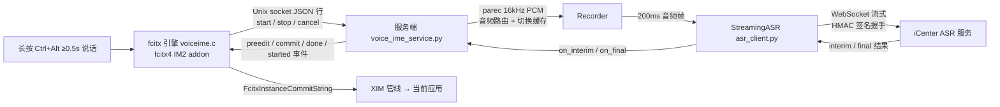

# voice-ime — ZTE 内网语音输入法（fcitx4 引擎版）

> **安装与使用：见 [INSTALL.md](INSTALL.md)**（面向 AI 代理的分步指南）

在 ZTE 内网环境下，用 iCenter 流式语音识别（ASR）把说话内容直接输入到当前应用的输入法引擎。
**长按 Ctrl+Alt ≥0.5s** 开始录音（可松手），**按 Escape** 停止提交——全程不碰剪贴板。

## 架构



三层职责：

| 层 | 文件 | 职责 |
|---|---|---|
| 引擎 | `fcitx-engine/voiceime.c` | fcitx 输入法插件：拦截 Ctrl+Alt、与 fcitx UI 集成、提交文本 |
| 服务 | `voice_ime_service.py` | Unix socket 服务：录音、调用 iCenter、把识别结果回推引擎 |
| ASR | `asr_client.py` | iCenter WebSocket 流式客户端：签名鉴权、音频发送、结果解析 |
| 图标 | `icons/gen_icons.py` | 搜狗式麦克风图标：imicon PNG + fcitx-voiceime SVG（面板托盘），随输入法激活显示 |

## 目录结构

```
voice-ime/
├── fcitx-engine/          # fcitx4 引擎（C 插件）
│   ├── voiceime.c         # 引擎主体
│   ├── fcitx-voiceime.conf# addon 配置（Category=InputMethod）
│   └── Makefile           # make && sudo make install
├── icons/                 # 图标（gen_icons.py 绘制 + SVG，imicon/主题源）
│   ├── gen_icons.py       # 图标生成脚本（cairo；--install 装 imicon + 主题 SVG）
│   ├── fcitx-voiceime.svg # 面板托盘图标（Nde 主题 panel/，随输入法激活显示）
│   └── voiceime.png       # imicon 源（48x48，引擎 iconName 对应文件）
├── voice_ime_service.py   # ASR 服务端（Unix socket + iCenter 流式）
├── asr_client.py          # iCenter 流式 ASR 客户端（含鉴权）
├── service.sh             # 服务/浮窗 启动停止管理（单实例，改 config 后 restart）
├── check_env.sh           # 环境检测（15 项，退出码 = 缺失数）
├── install.sh             # 一键安装（依赖→编译→图标→配置→启动→验证）
├── config.example.json    # 配置模板（凭证占位，不入库）
└── config.json            # ASR 凭证/参数（含密钥，不入库）
```

## 实现细节

### 1. 触发：长按 Ctrl+Alt 500ms 启动 + Escape 停止

fcitx 的 `DoInput` / `DoReleaseInput` 回调天然拿到所有按键（fcitx 处理键盘事件的入口），且**只在语音输入法激活时被调用**——所以拦截不影响搜狗等其它输入法。

**交互设计**（防误触优先）：

| 操作 | 行为 |
|---|---|
| **长按 Ctrl+Alt ≥500ms** | 开始录音（提示音 + 桌面浮窗声波动画指示），**可松手**，录音继续 |
| **按 Escape** | 停止并提交（未录音时 Escape 透传给应用） |
| <500ms 松开 | 忽略（防误触） |
| 长按期间 | 只触发一次（防 repeat），两键全部释放后才允许下次触发 |

实现要点：

```c
// DoInput：Ctrl+Alt 按下 → 进入 armed 状态并记录时刻（不立即触发）
if (is_ctrl(sym) || is_alt(sym)) {
    ...
    if (两键都按下 && !im->armed && !im->triggered) {
        im->armed = true;
        clock_gettime(CLOCK_MONOTONIC, &im->press_time);
    }
    return IRV_DO_NOTHING;   // 消费修饰键
}
// Escape：录音中停止并提交（press 触发 + esc_pressed 防 repeat）
if (sym == FcitxKey_Escape && im->recording && !im->esc_pressed) {
    im->recording = false;
    send_cmd(im, "{\"cmd\":\"stop\"}");
}
```

**500ms 判定**复用 20ms 主循环轮询（见第 3 节）：`armed` 且按住超 500ms → 触发 start，置 `triggered` 防重复；`DoReleaseInput` 在两键全释放时重置 armed/triggered（未满 500ms 松开则本次作废）。

**热键方案演进**（为什么最终用 fcitx 引擎）：

| 方案 | 问题 |
|---|---|
| `XGrabKey` 抓 Ctrl+Alt | 修饰键抓取会拦截系统级 Ctrl+Alt+任意键组合 |
| XRecord（libXtst） | 在 Xvfb/本机出现 BadMatch / 段错误，行为不稳定 |
| PollHotkey（XQueryKeymap 轮询） | 剪贴板版可用，但**纯监听**只能拿到键状态，拿不到 fcitx 输入上下文 |
| **fcitx 引擎 DoInput**（本方案） | fcitx 直接回调按键，天然拿到输入上下文，可 `CommitString` 提交 |

### 2. 提交：直接走 XIM，不碰剪贴板

Linux X11 下注入中文没有通用途径：Windows `SendInput` + `KEYEVENTF_UNICODE`、macOS `CGEvent` 可发 Unicode，但 X11 只认 keycode。剪贴板 + `xdotool key ctrl+v` 是唯一通用路径（早期剪贴板方案即此，借鉴 opentypeless：注入后 20ms settle + 750ms 恢复保护），但它会污染剪贴板、且焦点失控时可能误打，已移除。

fcitx 引擎版注册为 fcitx 输入法后，直接调用：

```c
FcitxInputContext* ic = FcitxInstanceGetCurrentIC(im->owner);
FcitxInstanceCommitString(im->owner, ic, text);   // 走 XIM 管线提交到当前应用
```

preedit（输入窗口提示）用 fcitx UI API：

```c
FcitxMessages* preedit = FcitxInputStateGetClientPreedit(input);
FcitxMessagesSetMessageCount(preedit, 0);
FcitxMessagesAddMessageStringsAtLast(preedit, MSG_INPUT, text);
FcitxUIUpdateInputWindow(im->owner);
```

### 3. 线程调度：fcitx4 主循环（关键坑）

引擎开 `g_thread_new` 读 Unix socket，但 **fcitx4 不驱动 glib 默认主循环 context**——`g_idle_add` / `g_timeout_add` 的回调**永远不会执行**（实测确认）。所有 UI 更新必须回到 fcitx 主循环线程。

正确做法：**recv 线程只写线程安全队列，主线程轮询**：

```c
// recv 线程：收到 preedit/commit → 入队（GAsyncQueue 线程安全）
g_async_queue_push(im->queue, msg);

// 主循环：Init 时注册 20ms 轮询（FcitxInstanceAddTimeout 调度到 fcitx 自己的 context）
FcitxInstanceAddTimeout(im->owner, 20, poll_queue_cb, im);
// poll_queue_cb：pop 队列 → preedit 显示 / CommitString 提交 → 重新注册轮询
```

`FcitxInstanceAddTimeout` 的另一个约束：**必须从主线程调用**（从 recv 线程注册 0ms 定时器实测不触发）。

### 4. 消息解析：JSON 空格兼容（踩坑）

服务端用 `json.dumps`（`"type": "preedit"` 冒号后有空格）发消息。引擎最初用 `strstr(line, "\"type\":\"preedit\"")`（无空格）匹配——**永远匹配不上**，所有 preedit/commit 静默丢弃，表现为"录音中…卡住、识别结果不上屏"。

修复：匹配 JSON 值本身（`strstr(line, "\"preedit\"")`），`extract_text` 同时兼容 `"text": "` 与 `"text":"` 两种形式，并修正偏移（`"text": "` 含内容开引号共 9 字符，偏移 +9）。

### 5. 服务端：Unix socket + 每连接独立会话

- 协议：`/tmp/voiceime-service.sock`，JSON 行（`\n` 分隔）
- 命令：`start` / `stop` / `cancel` / `ping` / `broadcast`（调试用）
- 事件：`preedit`（中间结果）/ `commit`（最终文本）/ `done`（会话结束）/ `started`（服务端已开始录音）
- **每连接独立会话**（`Session` 绑定自己的 `send`）：引擎重连不串线、命令不串扰
- **引擎状态同步**：服务端会话开始发 `started`、结束发 `done`，引擎据此同步 `recording`（收到 `done` 复位、`started` 置位）——60s 自动续录/静音自动停止后引擎状态不漂移，Escape 始终可停止

### 6. 停顿分句：final 即时提交

iCenter 在停顿处会分句：旧句产出 final 结果、新句开始新的 interim。如果 final 攒到松手才提交，preedit 会被新句覆盖，看起来"内容丢失"。

服务端对每个 final 立即 `commit`（上屏），用 `committed` 计数避免 stop 时重复提交；stop 只补剩余未上屏的句子。提交后 preedit 显示"…"提示仍在录音。

### 7. iCenter 集成（asr_client.py）

- **签名**：`payload = app_id|source|user_id|ts`，`sig = "sha256=" + HMAC-SHA256(secret, payload)`，签名头放在 **WebSocket 握手**（浏览器做不到，故需 Python 服务端代理）
- **UAC token**：`https://127.0.0.1:{port}/requestToken?appId=...` 解析 `APPACCESSTOKEN` / `ZTEDPGSSOUser`，放入 StartTranscription 消息 header
- **音频**：PCM 16kHz / 16bit / mono，200ms chunk（6400B），`format: "wav"` 但发裸 PCM（无 44B 头）
- **流式协议**：`StartTranscription` → 音频二进制帧 → `StopTranscription` → `TranscriptionCompleted`
- **环境**：测试环境不可用（1008），灰度/生产可用
- **已知延迟**（iCenter 服务端限制，客户端无法减少）：松手 → final 结果约 0.6s；中间结果更新频率约 1s/次

### 8. 60s 单次会话上限：无缝续录（零丢失）

iCenter 文档规定**单次 WebSocket 会话**最长 60s（实测快速发 66s 数据服务端照单全收——限制是会话时长，不是数据量）。为支持长话，服务端在 60s 时**切换 ASR 会话而非断开录音**：

```
常驻录音（单个 parec，不重启）──▶ 音频路由
                                    ├─ 当前 ASR 会话（直接发）
                                    └─ 切换窗口（缓存，新会话接管后补发）
```

- **Recorder 路由模式**：chunk 发往当前 ASR 连接；切换窗口（无目标/发送失败）音频进内存缓存
- **60s 到（switch_session）**：旧会话 `StopTranscription` 收尾提交（`done` 先行）→ 新会话 `StartTranscription` 接管**同一录音流**（`started` 后置，引擎状态顺序一致）→ 缓存先补发再实时 → 递归续录，无限长话
- 音频流零中断、内容零丢失；切换间隙约 0.5-1s 的内容靠缓存补发（识别结果略晚到，不丢）
- 静音超时 / Escape / 连接断开**不**触发续录

### 9. 静音超时自动停止（双阈值）

Recorder 逐 chunk（200ms）计算 PCM RMS，低于 `silence_rms_threshold` 计为静音：

- **从未识别到内容**（`heard_speech=false`）：连续静音 `silence_timeout_sec`（默认 15s）自动停止提交——快速回收"开了不说的录音"
- **已识别到内容后**：静音上限放宽到 `silence_after_input_sec`（默认 30s）——说话中的自然停顿（思考/换气/念诗节奏）不误断
- 任何一次有声（RMS ≥ 阈值）都**重置**静音计时（不是累计）
- 停止方式与 Escape 相同（停止并提交），带代际防误停新会话

### 10. 提示音

服务端启动时用 Python `wave` 预生成两个短音（`/tmp/voiceime-beep-{start,stop}.wav`），录音开始播 880Hz 短音、结束播 440Hz 长音（`paplay`，零依赖）；60s 续录为静默切换不播音，避免打断。

### 11. 麦克风互斥与释放

PulseAudio 底层**允许多个应用同时录音**（多路广播），但部分 Qt 应用（如 ZTE iCenter）的 PulseAudio 后端把"麦克风正被其他流使用"判定为**设备占用**，打开时会提示"话筒被占用"并拒绝：

- **voice-ime 总能抢到麦克风**：parec 不检测占用、直接加入多流，即使会议软件正在录音也能正常识别
- **会议软件先开后不受影响**：它已打开录音流，voice-ime 后加入 → 两者共存（对方听得到 + 语音输入正常）
- **voice-ime 先录音时**，会议软件后打开会被其自身的占用检测拒绝（应用层行为，无法绕过）
- **释放**：Escape 停止、静音超时自动停、连接断开、服务退出（含 `kill`，服务端收到 SIGTERM 会停止所有录音）都会终止 parec、释放麦克风——不录音时不占用

### 12. 输入法图标（搜狗同款机制，随输入法切换）

**位置**：fcitx 自己的托盘图标（StatusNotifierItem，Nde 面板托盘里）。fcitx 激活输入法时把托盘图标换成**当前输入法的图标**，由 `IconName` 从图标主题加载：

| fcitx 状态 | SNI IconName | 主题图标 | 显示 |
|---|---|---|---|
| 未激活/键盘 | `input-keyboard` | —（内置） | 键盘 |
| 激活搜狗 | `fcitx-sogouimebs` | `fcitx-sogouimebs.png/svg`（搜狗安装的） | S 图标 |
| **激活语音输入** | **`fcitx-voiceime`** | **`fcitx-voiceime.svg`（本项目安装，panel/ 主题）** | **麦克风图标** |

- 机制：fcitx notificationitem 模块按 `"fcitx-" + IM 注册的 iconName` 设置 SNI `IconName`（已实测：激活 voiceime 时 `IconName="fcitx-voiceime"`，失活 `input-keyboard`）；面板按 IconName 查主题
- **安装**：`python3.6 icons/gen_icons.py --install` 装 `fcitx-voiceime.svg` 到 Nde 主题 Dark/Light/Fashion 的 `panel/` 与 `actions/`（8 个尺寸目录，与搜狗 `fcitx-sogouimebs` 完全同布局）；Nde 面板托盘只从主题 `panel/` 加载 SVG（已实证：`panel/` 目录 1854 个图标全为 SVG）
- 图标：搜狗式圆角渐变方块 + 白色麦克风（`icons/gen_icons.py` cairo 绘制 + `icons/fcitx-voiceime.svg` 矢量）
- 引擎注册 `iconName="voiceime"`（`FcitxInstanceRegisterIMv2` 第 5 参数）+ 安装 `imicon/voiceime.png`（XEmbed 系统托盘 GetIMIcon 用；SNI 路径下不生效但保持注册一致）
- 激活信号（`im_active` 上报）不影响图标显示，仅用于服务端日志/诊断

## 构建与安装

```bash
# 引擎（需要 fcitx-devel；内网 yum 需显式 no_proxy）
cd fcitx-engine
make && sudo make install        # 装 .so 到 /usr/lib64/fcitx/，conf 到 /usr/share/fcitx/addon/

# 图标（生成 imicon PNG + fcitx-voiceime.svg；--install 装到 fcitx 与 Nde 主题，需 sudo）
python3.6 icons/gen_icons.py --install

# 服务（Python 3，无第三方依赖；依赖系统 parec）+ 浮窗
./service.sh start               # 单实例启动，日志 logs/voiceime-service.log

# 重启 fcitx 加载新引擎（.so 只在启动时加载，fcitx-remote -r 不生效）
pkill fcitx && sleep 2
export DISPLAY=:0 DBUS_SESSION_BUS_ADDRESS="unix:path=/run/user/1000/bus"
setsid fcitx -d
```

## 使用

1. 输入法切换到「语音输入」
2. 聚焦目标输入框
3. **按住 Ctrl+Alt ≥0.5s** 开始录音（提示音 + **屏幕中央偏上的声波动画浮窗**指示，随音量跳动；可松手）
4. 停顿处句子自动上屏；**按 Escape** 停止并提交
5. 说话中的停顿不中断（静音上限见配置表）；**长话超过 60s 自动无缝续录**（音频不中断、内容零丢失，直到 Escape 才真正停止）

**草稿模式**（默认关闭，直接上屏）：录音过程中**单独按一下 Ctrl**（期间不按其它键，松开触发；Ctrl+C 等组合键不误触）→ 弹出草稿窗口，之后说话的内容不再上屏、实时进草稿（句子完成追加一行、当前句实时更新）。再按一次 Ctrl 切回直接上屏。草稿窗口内：

原文区**可直接编辑**：语音识别可能把系统名、工具名等专有名词转写错，可在点优化前手动修正（优化使用修正后的文本）。
窗口底部仅一个居中的**优化**按钮：把草稿全文发给 `config.json` 的 `llm` 段配置的大模型（去口头语/感叹词），**成功后自动复制到剪贴板并提示，约 2 秒后自动关闭窗口**（失败则不关闭，显示错误原因）。关闭窗口（X 按钮）即退出草稿模式并清空内容。
- **关闭/隐藏窗口 = 退出草稿模式**（恢复直接上屏）并清空内容，下次打开是全新的

配置项（`config.json`）：

| 键 | 默认 | 说明 |
|---|---|---|
| `silence_timeout_sec` | 15 | **从未识别到内容**时连续静音自动停止（秒），0 关闭 |
| `silence_after_input_sec` | 30 | **已识别到内容后**的静音上限——说话中的自然停顿（思考/换气）不误断，0 与前者相同 |
| `silence_rms_threshold` | 300 | 静音判定振幅阈值（PCM 16bit RMS），底噪高的环境可调大 |
| `osd.width` | 180 | 录音指示浮窗宽度（px） |
| `osd.height` | 38 | 录音指示浮窗高度（px） |
| `osd.y_ratio` | 0.80 | 浮窗垂直位置（屏幕高度比例，0~1；水平始终居中） |
| `focus_lost_stop` | false | **失去焦点时自动停止录音并释放麦克风**；false = 切窗口不中断（录音继续，需 Escape/静音停止） |
| `llm.endpoint` | DeepSeek API | 优化用大模型的 chat/completions 地址（OpenAI 兼容格式），草稿窗口"优化"按钮调用；默认 DeepSeek 官方地址 |
| `llm.api_key` | `DEEPSEEK_API_KEY` | **环境变量名**（不是密钥本身）：取值时从该环境变量读取，如 `export DEEPSEEK_API_KEY=sk-...` 后重启服务；留空默认用 `DEEPSEEK_API_KEY` |
| `llm.model` | `deepseek-v4-flash` | 模型名（DeepSeek v4：`deepseek-v4-flash` 快速 / `deepseek-v4-pro` 更强；旧名 `deepseek-chat` 已停用）；请求已显式关闭思考模式 |
| `llm.system_prompt` | 见模板 | system 角色提示词：角色定义 + 全部润色规则（删口头语/修语病）+ 标签输出约束；留空则不发送 system 消息 |
| `llm.prompt` | `原文：` | user 消息前缀，后面接待润色文本；只放原文，规则都在 system_prompt 里 |
| `hold_ms` | 300 | **长按 Ctrl+Alt 触发语音输入的阈值**（毫秒），服务启动时经 config 消息下发给引擎 |

浮窗配置修改后执行 `./service.sh restart` 生效。

## 调试

```bash
cd voice-ime && tail -f logs/voiceime-engine.log   # 引擎：按键事件、收到 preedit/commit、poll_queue 处理
tail -f logs/voiceime-service.log  # 服务：命令、录音、识别结果
tail -f logs/voiceime-osd.log      # 浮窗
ss -x | grep voiceime              # 引擎↔服务 socket 连接（应为 1 条 ESTAB）
fcitx-remote -s voiceime           # 切换输入法（-m 只是查询 addon 名）
```

三个日志都在**应用目录的 `logs/` 子目录**（`voice-ime/logs/`）下，不在 /tmp。

## 历史方案（已移除）

- `voice-ime/voice_ime.py` 剪贴板版（PollHotkey + 剪贴板注入）：最早验证了链路，但污染剪贴板/焦点，已被 fcitx 引擎取代并删除。设计演进见上文「热键方案演进」表。
- `asr-demo/`（仓库根）：iCenter 流式接口测试页（HTML + 鉴权代理），最早验证 WebSocket 鉴权与流式结果
